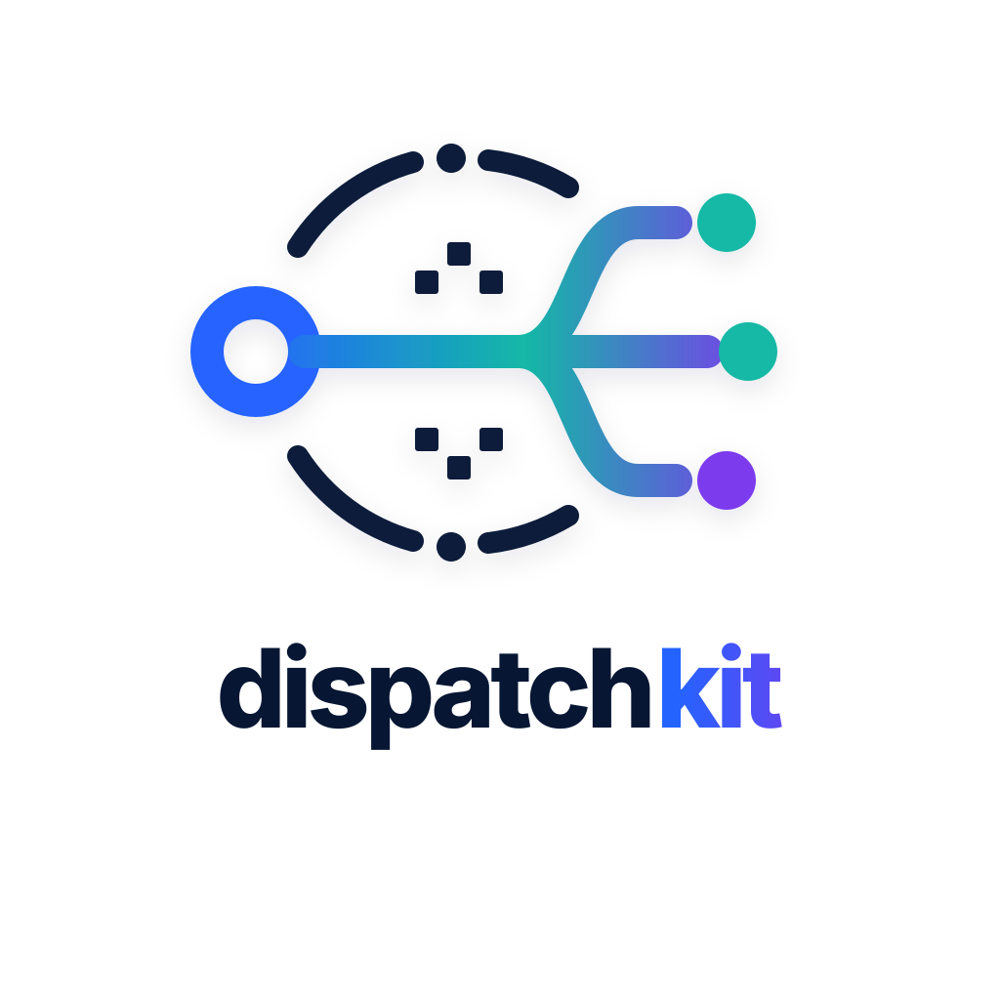

<p align="center">
  
</p>

<h1 align="center">Dispatchkit</h1>

<p align="center">
  <code>@orria/dispatchkit</code>. CQRS-lite runtime toolkit for Bun.
</p>

## Features

- CQRS operation definitions: `defineQuery`, `defineMutation`, `defineAction`
- Runtime modules: `defineConfig`, `defineLogger`, `defineInfra`, `defineTransport`
- Runtime builder: `buildRuntime()`
- Strict CQRS call guards at runtime
- Standard Schema validation for config and operation `input` and `return`, plus type-only `typed<T>()`
- Resource cleanup through `onDispose()` and `runtime.dispose()`
- Context helpers: `getModuleCtx()`, `getTransportCtx()`
- Runtime artifact generation into `src/generated/runtime`
- CLI: `dispatchkit generate` and event-based `dispatchkit generate --watch`
- `DispatchkitError` with machine-readable `code`

## Installation

```bash
bun add @orria/dispatchkit
```

Install a validator separately. The Zod examples below use `bun add zod`; Valibot uses `bun add valibot`. Dispatchkit has no mandatory Zod dependency. Env files are parsed with the built-in `node:util` `parseEnv`. A custom logger such as `pino` is optional through `defineLogger`.

## Minimal app structure

```text
src/
├── index.ts
├── config.ts              # optional (defineConfig)
├── logger.ts              # optional (defineLogger)
├── modules/
│   └── widget/
│       ├── get.query.ts
│       ├── upsert.mutation.ts
│       └── upsert.action.ts
├── infra/
│   ├── repo.ts
│   └── db/index.ts
└── transport/
    ├── http.ts
    └── cli/index.ts
```

## Quick start

### 1) Define operations

```ts
// src/modules/widget/get.query.ts
import { defineQuery } from "@orria/dispatchkit";
import { z } from "zod";

export default defineQuery({
  input: z.object({ id: z.string() }),
  return: z.object({ id: z.string() }).nullable(),
  handler: async (ctx) => {
    return ctx.infra.repo.get(ctx.input.id);
  },
});
```

Each operation becomes available on `runtime.bus`:

- `runtime.bus.query.widget.get(input)`
- `runtime.bus.query.widget.get.$unsafe(input)`
- `runtime.bus.query.widget.get.$input`
- `runtime.bus.query.widget.get.$return`

Nested module paths also generate grouped keys:

- `modules/widget/get.query.ts` -> `runtime.bus.query.widget.get(...)`
- Flat alias is also present: `runtime.bus.query.widgetGet(...)`

### 2) Optional runtime config

```ts
import { defineConfig } from "@orria/dispatchkit";
import { z } from "zod";

export default defineConfig(
  z.object({
    PORT: z.coerce.number().int().min(1).max(65535).default(3000),
  }),
);
```

Built-in runtime config keys:

- `SERVICE_NAME`
- `SERVICE_DESCRIPTION`
- `SERVICE_VERSION`
- `LOG_LEVEL` (`fatal|error|warn|info|debug|trace|silent`)
- `NODE_ENV` (`development|production`)

Config merge priority, with later sources overriding earlier ones:

1. Defaults from `package.json`
2. `process.env`
3. `.env` file
4. `buildRuntime(options).config`
5. Top-level config keys in `buildRuntime(options)`

The schema receives this merged input and must produce an object. Its parsed output is merged with the built-in keys, so a schema that strips unknown properties keeps `SERVICE_NAME` and the other defaults. Built-in fields are validated again after custom transforms. Without `defineConfig`, runtime config contains only the built-in keys. `NODE_ENV=test` is normalized to `development`.

### 3) Optional logger

```ts
import { defineLogger } from "@orria/dispatchkit";
import pino from "pino";

export default defineLogger((config) => {
  const logger = pino({
    name: String(config.SERVICE_NAME),
    level: String(config.LOG_LEVEL),
  });

  return {
    logger,
    console,
  };
});
```

If `src/logger.ts` is missing, Dispatchkit uses a fallback `console`-based logger filtered by `LOG_LEVEL`.

### 4) Infra modules

```ts
// src/infra/repo.ts
import { defineInfra } from "@orria/dispatchkit";

export default defineInfra(({ config, logger, onDispose }) => {
  logger.info("infra init", { service: config.SERVICE_NAME });
  const records = new Map<string, { id: string }>();
  onDispose(() => records.clear());

  return {
    get: (id: string) => records.get(id) ?? null,
  };
});
```

`defineInfra()` receives `{ config, logger, onDispose }`.

Return behavior:

- `src/infra/database.ts` -> `runtime.infra.database`
- `src/infra/database/index.ts` -> `runtime.infra.database`
- The module return value is assigned to that key, including class instances.

### 5) Transport modules

```ts
import { defineTransport } from "@orria/dispatchkit";

export default defineTransport(
  () => ({
    ping: () => "pong",
  }),
  {
    allowGetTransportCtxFrom: ["http", "transport/http/**/*.ts"],
  },
);
```

`allowGetTransportCtxFrom` extends default allowed locations for `getTransportCtx()`.
Shorthand values like `"http"` are supported.

Transport wrappers support methods on class prototypes. JavaScript requires non-configurable, non-writable own properties to return their exact values. Functions and objects held in those properties do not get additional context wrappers.

### 6) Build runtime

```ts
import { buildRuntime } from "@orria/dispatchkit";

const runtime = await buildRuntime({
  rootDir: process.cwd(),
  srcDir: "./src",
  generatedDir: "./src/generated/runtime",
  envFile: "./.env",
  SERVICE_NAME: "my-service",
});
```

Runtime shape:

- `runtime.config`
- `runtime.logger`
- `runtime.infra`
- `runtime.bus`
- `runtime.transport`
- `runtime.dispose()`

After a successful build, Dispatchkit mounts `globalThis.runtime` and the configured console. Set `mountGlobal: false` to keep runtime instances separate from those globals. Context helpers still work inside their handlers and transport calls.

Relative `srcDir`, `generatedDir`, and `envFile` paths resolve from `rootDir`. By default, `rootDir` is the current working directory. Set `generateArtifacts: false` when generated types are already part of the build or the runtime filesystem is read-only:

```ts
const runtime = await buildRuntime({
  rootDir: import.meta.dir,
  srcDir: "src",
  mountGlobal: false,
  generateArtifacts: false,
});
```

## Standard Schema validation

`defineConfig` and operation `input` and `return` accept [Standard Schema v1](https://standardschema.dev/) validators. Zod 4 and Valibot 1 schemas work directly. Validation can be synchronous or asynchronous, including refinements and transforms. Different validators can be used in the same operation:

```ts
// src/modules/increment.query.ts
import { defineQuery } from "@orria/dispatchkit";
import * as v from "valibot";
import { z } from "zod";

export default defineQuery({
  input: z.string().regex(/^\d+$/).transform(Number),
  return: v.pipe(v.number(), v.transform(String)),
  handler: ({ input }) => input + 1,
});
```

The bus accepts the input schema's input type. The handler receives its output type, after parsing. The handler returns the return schema's input type, and the bus resolves to its output type. Without a return schema, the bus infers the handler's result.

If a handler calls its own generated bus method, give the handler an explicit return type so TypeScript can resolve the recursion.

```ts
await runtime.bus.query.increment("41"); // "42"
await runtime.bus.query.increment.$unsafe(41); // 42
```

`$unsafe` skips both validators and all their transforms. It takes the value the handler normally receives and returns the handler's raw result. CQRS guards still apply. `$input` and `$return` expose the original schema objects, or `undefined` when omitted.

### Type-only schemas

`typed<T>()` gives `input`, `return` or config a TypeScript type without runtime validation. The bus
skips it entirely, so it costs nothing at runtime:

```ts
import { defineQuery, typed } from "@orria/dispatchkit";

export default defineQuery({
  input: typed<{ id: string }>(),
  handler: ({ input, infra }) => infra.repo.get(input.id),
});
```

### Elysia and TypeBox

Elysia's `t` schemas need an adapter. Choose the subpath that matches the TypeBox version:

| Schema source                      | Install alongside Dispatchkit | Adapter import                  |
| ---------------------------------- | ----------------------------- | ------------------------------- |
| Elysia 1, `@sinclair/typebox` 0.34 | `bun add @sinclair/typebox`   | `@orria/dispatchkit/typebox`    |
| Elysia 2, `typebox` 1              | `bun add typebox`             | `@orria/dispatchkit/typebox-v1` |

The adapters are optional imports; the core does not load TypeBox. Elysia 2 integration is tested with `elysia@2.0.0-beta.14` and `typebox@1.3.28`.

```ts
import { standardSchema } from "@orria/dispatchkit/typebox";
// Elysia 1
import { t } from "elysia";

const input = standardSchema(t.Object({ id: t.String() }));
```

For Elysia 2, use `standardSchema(schema, context?)` from `@orria/dispatchkit/typebox-v1`. The optional `context` maps names to referenced schemas. Elysia 2's `t.Numeric()` keeps separate input and output types:

```ts
// Elysia 2
import { defineQuery } from "@orria/dispatchkit";
import { standardSchema } from "@orria/dispatchkit/typebox-v1";
import { t } from "elysia";

export default defineQuery({
  input: standardSchema(t.Object({ count: t.Numeric() })),
  handler: ({ input }) => input.count + 1,
});
// Bus input: { count: string | number }. Result: number.
```

The TypeBox 0.34 adapter accepts `standardSchema(schema, references?)` and preserves validation and `Decode` transforms. For explicit encoded and decoded types, use TypeBox's own `Type.Transform`:

```ts
import { defineQuery } from "@orria/dispatchkit";
import { standardSchema } from "@orria/dispatchkit/typebox";
import { Type } from "@sinclair/typebox";

export default defineQuery({
  input: standardSchema(
    Type.Transform(Type.String())
      .Decode((value) => value.length)
      .Encode(String),
  ),
  handler: ({ input }) => input * 2,
});
// Bus input: string. Handler input and bus result: number.
```

Elysia 1 declares `t.Numeric()` as `TNumber`, although it accepts numeric strings at runtime. Its `t.Transform` also exposes a different static type than TypeBox's version. The adapter preserves these runtime conversions, but it cannot recover input types that Elysia's declarations omit. Use `Type.Transform` when encoded input types matter. Both adapters use TypeBox's synchronous decoding APIs. They do not run Elysia's HTTP coercion, defaults, or cleaning pipeline.

Elysia 2 schemas that depend on its private asynchronous refinement queue, including file signature checks with `t.File({ type: "image/png" })` or `t.Files({ type: "image/png" })`, fail with `DISPATCHKIT_TYPEBOX_ASYNC_REFINE_UNSUPPORTED`. Validate file signatures through Elysia's HTTP pipeline or a Standard Schema validator with asynchronous validation. Basic `t.File()` and size checks are supported, as are `t.Numeric()`, `t.BooleanString()`, and `t.Date()`.

## Resource lifecycle

Infra and transport factories receive `onDispose(callback)`. Register cleanup immediately after acquiring a resource:

```ts
// src/transport/http.ts
import { defineTransport } from "@orria/dispatchkit";

export default defineTransport(({ onDispose }) => {
  const server = Bun.serve({
    port: 3000,
    fetch: () => new Response("ok"),
  });
  onDispose(() => {
    server.stop(true);
  });
  return server;
});
```

Call `await runtime.dispose()` during application shutdown. Cleanup runs once, in reverse registration order, and awaits each callback. All callbacks run even if one fails; cleanup errors are reported in an `AggregateError`. New bus calls fail after disposal. Dispatchkit does not install process signal handlers or close unregistered resources.

A failed `buildRuntime()` runs the registered cleanup callbacks and leaves the previously mounted runtime and console intact. Building another runtime does not dispose the previous one; keep its reference and call `dispose()` when it is no longer needed.

## Context helpers

- `getModuleCtx()` returns `{ config, logger, infra, bus }`
- `getTransportCtx()` returns `{ config, logger, bus }`

Factory/handler context matrix:

- `defineLogger((config) => ...)` -> `config`
- `defineInfra((ctx) => ...)` -> `{ config, logger, onDispose }`
- `defineTransport((ctx) => ...)` -> `{ config, logger, bus, onDispose }`
- `defineQuery/defineMutation/defineAction.handler(ctx)` -> `{ config, logger, infra, bus, input }`

Invalid context access throws structured errors:

- `DISPATCHKIT_CONTEXT_UNAVAILABLE`
- `DISPATCHKIT_CONTEXT_FORBIDDEN`

Bun caches application modules; their top-level code runs once per process. A transport module can read `getTransportCtx()` during its initial import, but a captured value keeps referring to that first runtime when another runtime reuses the module. For multiple runtime instances, read runtime-dependent values inside factories, handlers, or transport methods.

## CQRS guards

Runtime enforces call chain restrictions:

- `query` -> only `query`
- `mutation` -> `query`, `mutation`
- `action` -> `query`, `mutation`, `action`

Invalid calls throw `DISPATCHKIT_CQRS_GUARD`.

## Errors

Framework errors are `DispatchkitError` instances. `code` holds the `DISPATCHKIT_*` prefix of the
message, so errors can be handled without parsing strings:

```ts
import { DispatchkitError } from "@orria/dispatchkit";

try {
  await runtime.bus.query.user({ id: 1 });
} catch (error) {
  if (error instanceof DispatchkitError && error.code === "DISPATCHKIT_VALIDATION_ERROR") {
    console.warn(error.message, error.cause); // cause: StandardSchemaError with `issues`
  }
}
```

`StandardSchemaError` (code `DISPATCHKIT_SCHEMA_VALIDATION_ERROR`) extends `DispatchkitError`.

## Discovery rules

Dispatchkit scans under `srcDir`:

- `modules/**/*.query.ts`
- `modules/**/*.mutation.ts`
- `modules/**/*.action.ts`
- `infra/*.ts` and `infra/**/index.ts`
- `transport/*.ts` and `transport/**/index.ts`

Notes:

- `*.d.ts` files are ignored
- Operation and transport naming collisions throw errors
- An infra module exporting `defineTransport(...)` is treated as transport

Runtime and CLI share the same discovery rules. Static classification follows named import aliases, namespace imports, `const` bindings, and local imports and re-exports. The generator does not execute application modules. Dynamic wrappers and mutable definitions that cannot be classified fail with `DISPATCHKIT_DISCOVERY_UNKNOWN_DEFINITION`. Export `defineInfra(...)` or `defineTransport(...)` through one of the supported forms.

## Generated artifacts

Default output directory: `src/generated/runtime`

- `manifest.json`
- `bus.d.ts`
- `runtime.d.ts`
- `index.ts`

`manifest.json` is rewritten only when the discovery structure changes.

Run `dispatchkit generate` before type checking and include the generated declarations in your TypeScript project. The default `src/generated/runtime` path is covered by an `include` pattern such as `src/**/*.ts`.

## CLI

```bash
# one-time generation
dispatchkit generate

# watch mode
dispatchkit generate --watch

# custom paths
dispatchkit generate --srcDir ./src --generatedDir ./src/generated/runtime
```

`--watch` updates generated types and the manifest as files change. It does not reload application modules in a running process. Watching is event-based (`fs.watch`): changes are debounced (`--debounceMs`, default 100ms) and nothing is polled while idle.

Options:

- `--rootDir <path>`
- `--srcDir <path>`
- `--generatedDir <path>`
- `--watch`
- `--debounceMs <ms>`
- `--intervalMs <ms>` (deprecated alias of `--debounceMs`)

Programmatic watching can be stopped with an `AbortSignal`:

```ts
import { watchRuntime } from "@orria/dispatchkit";

const controller = new AbortController();
const watching = watchRuntime({ debounceMs: 50, signal: controller.signal });
// ...
controller.abort();
await watching;
```

## Performance

Hot paths are benchmarked in [`bench/`](bench/README.md). An A/B run of 1.2.0 against the
published 1.1.0 in one session (`bun run bench:compare -- --ref v1.1.0`, best of 5 runs, Bun
1.4.4, Apple M1 Pro):

| Scenario                          |        1.1.0 |        1.2.0 |      Change |
| --------------------------------- | -----------: | -----------: | ----------: |
| bus call without schema           |       289 ns |       146 ns |        −49% |
| bus call with zod / valibot input | 407 / 405 ns | 290 / 270 ns | −29% / −33% |
| nested bus call (2 levels)        |       573 ns |       322 ns |        −44% |
| transport method (plain / class)  | 268 / 264 ns | 170 / 189 ns | −37% / −28% |
| `getTransportCtx()`               |      20.8 µs |       1.3 µs |        −94% |
| `buildRuntime` (warm)             |      0.28 ms |      0.17 ms |        −40% |

## Develop this package

Requires Bun 1.4.3+: formatting, linting and type checking use the built-in `bun fmt`, `bun lint`
and `bun check`, configured in `bunfig.toml`.

```bash
bun run verify        # bun fmt --check, bun lint (zero warnings), bun check, tests
bun run build         # build into dist/ (TypeScript 7)
bun run bench         # benchmarks vs bench/baseline.json (`-- --check` fails on regressions)
bun run bench:update  # record a new baseline
bun run bench:compare # A/B vs HEAD; changes must not be >5% slower (AGENTS.md)
```

## Documentation

- Russian version: [`docs/README.ru.md`](docs/README.ru.md)
